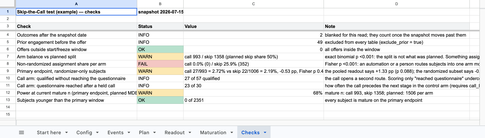
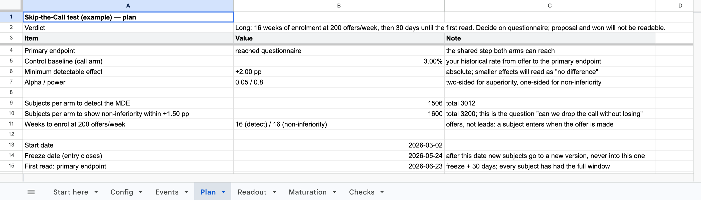

# skip-the-call-test

**Do we still need the qualification call?** A test kit for sales-led companies with a long
deal cycle: plan the A/B, collect one table, read the result honestly. Google Sheets plus
Apps Script, no install, nothing to host. The statistics and every trap we fell into are in
the repo; the data stays in your sheet.

## Start in two minutes

1. **[Make a copy of the template](https://docs.google.com/spreadsheets/d/1Aq0X8NB7Qmnr-lb_Zyf0T3pODylRRAheALs8h4PRSQg/copy)** (a Google account is all you need). It opens
   filled with a synthetic example, so every tab is already readable before you run anything.
2. **Read Checks, then Readout.** The example has one planted bug: an auto-reply that routes
   early responders into one arm. Checks flags it as FAIL; Readout shows what it does to the verdict.
3. **Is your volume enough?** Put your three numbers in Config (`baseline_rate`, `mde`,
   `offers_per_week`) and run **Skip-the-Call → 1. Plan**. The first line is the verdict:
   feasible, long, or not practical, and which endpoints you will be able to read. No data needed.

The first menu run asks for permission: the script touches this spreadsheet only
(`@OnlyCurrentDoc`), no other files, no network. Google may show "unverified app" for a script
that has not been through its OAuth verification; `docs/setup.md` says what to click. No Google account:
`node examples/plan.js --baseline 3% --mde 2% --per-week 200` prints the same Plan.

## Or ask Claude

The repo is also a skill for Claude Code: `SKILL.md` tells the agent how to size the test,
join your exports on several keys, run the readout and write a conclusion that survives the
traps below. Install it once:

```bash
git clone https://github.com/Vadim2090/skip-the-call-test ~/.claude/skills/skip-the-call-test
```

Then ask in plain words: *"we get 150 leads a week and 4% of them reach the demo after an
intro call; can we test dropping the call?"*, or hand it your CRM and form exports. It needs
Node 18+ and Python 3; the scripts run locally and make no network calls.



```
Config (your assumptions)  +  Events (one row per subject offered)
        │
        ▼  menu: Skip-the-Call → 1. Plan / 2. Readout
Plan · Readout · Maturation · Checks
```

## Who this is for

You run outbound or inbound into a sales team. Before a lead reaches the step that actually
qualifies them (a questionnaire, an intake form, a trial, a scoping doc) a rep takes a
10–20 minute call. Someone is now asking whether that call is necessary, because:

- reps are over capacity and the calendar is the bottleneck, not demand;
- leads take weeks to get from "interested" to "qualified" and the call is a large part of it;
- no-shows on the intro call are a third or more of bookings;
- somebody tried "send them straight to the form" on one channel and now two people hold
  opposite opinions about what happened.

The kit answers one question: **does removing the call lose qualified cases, and how many?**
It will not tell you which flow makes more revenue unless your volume is far above what most
B2B teams have; the Plan tab says so in numbers before you start.

## What we learned running it

The answer depends on where you cut the funnel, and the same data can produce three
different verdicts. From the synthetic example that ships with the kit (`examples/`), where
the true next-stage rate is **equal** in both arms by construction:

| Reading | Call arm | Skip arm | Difference | p | What a reader would conclude |
|---|---|---|---|---|---|
| next stage, all subjects, mature | 27 / 993 = 2.7% | 55 / 1,358 = 4.1% | +1.3 pp | 0.09 | "skip is non-inferior, probably better" |
| next stage, **randomized subjects only** | 27 / 993 = 2.7% | 22 / 1,006 = 2.2% | −0.5 pp | n.s. | parity, as planted |
| next stage, read 7 weeks in, pooled | 3 / 237 = 1.3% | 15 / 346 = 4.3% | +3.1 pp | 0.05 | "skip wins" (an early read on a selection effect) |
| proposal, mature | 26 / 993 = 2.6% | 19 / 1,358 = 1.4% | −1.2 pp | 0.05 | "the call wins" |

Nothing in that table is a bug in the data. The skip arm is inflated by an auto-reply that
routes early responders into it (the planted selection bias; the Checks tab flags it as a
FAIL). The call arm reaches proposal more often because the call opens a **second route to
qualification** that never touches the next stage, so "reached the next stage" undercounts it
by construction. The test this kit comes from showed the same pattern; `docs/field-notes.md`
tells that story on an illustrative sample (the company's own numbers are not published).

So the kit does three things most A/B write-ups skip:

1. **Reads every endpoint side by side**: next stage, qualified by any route, proposal, won,
   and says which one you are deciding on.
2. **Separates the treatment effect from the selection effect** by recording who assigned the
   arm (randomizer, automation, person) and recomputing the comparison on the randomized subset.
3. **Reads at maturity**: subjects are compared only after they have had the full window, and
   the plan gives you the dates before the first offer goes out.

## The traps

Each one was made at least once, and each is a line in the Checks tab or a column in the
Readout. Details and the fix for each: `docs/traps.md`.

| # | Trap | Catches it |
|---|---|---|
| 1 | The verdict depends on the endpoint; the call has a second route | both endpoints in the Readout; "qualified without next stage" check |
| 2 | An automation that is not arm-aware picks the winner | arm balance test; assignment-source share; randomizer-only line |
| 3 | A younger cohort cannot show late conversions | mature n and within-window columns; exposure-correct maturation; read dates |
| 4 | Mix: one arm has more of a high-converting segment | by-segment table with each segment's share per arm |
| 5 | Same word, different denominator | contract: offered = first arm-bearing touch; first stage entry, not current stage |
| 6 | A test that never closes cannot be read | freeze date; offers-outside-window check |
| 7 | A null result is not parity | interval of the difference; non-inferiority verdict; power at current n |
| 8 | One join key undercounts, silently | `adapters/join_keys.py` matches on several keys, refuses collisions, reports the match rate |

## How to run it, in five steps

1. **Name the next stage and both endpoints.** The next stage is the step both arms can reach
   (the form, the trial). The second endpoint is "qualified by any route", which includes
   whatever the call does on its own. Write both down before the first read.
2. **Size it.** Fill Config with your historical offer-to-next-stage rate, the smallest
   difference worth acting on, and your weekly offer volume. **1. Plan** gives the verdict,
   subjects per arm, weeks to enrol, the freeze date, the read dates, and which endpoints are
   readable at your volume. If proposal or won come back "not readable", decide now that you will judge on
   the next stage.

   

3. **Fix the randomization.** One split, at one point, before any automation or person touches
   the subject. Make every auto-reply, sequence and chatbot arm-aware, or turn them off for the
   test. Log the assignment source per subject; it is a column in the Events table.
4. **Collect one table.** One row per subject offered: arm, offer date, assignment source,
   and the dates of each outcome. `docs/data-contract.md` says what each column means and
   how to derive it from a CRM; `adapters/map_csv.py` maps any export into the shape
   (`examples/crm-export-sample.csv` + `examples/mapping-sample.json` is a worked example).
5. **Read on the dates, in order.** Checks first. Then the primary endpoint block of the
   Readout: mature rates, the interval of the difference, the non-inferiority verdict. Then
   "qualified by any route". A null result is reported with its interval, never as "no difference".

## Get the template

- **Google Sheets** (recommended): **[make a copy](https://docs.google.com/spreadsheets/d/1Aq0X8NB7Qmnr-lb_Zyf0T3pODylRRAheALs8h4PRSQg/copy)**. To build it from the repo
  instead (paste the four `src/` files, or `clasp push`): `docs/setup.md`.
- **Node, locally**: `node examples/plan.js --baseline 3% --mde 2% --per-week 200` for the
  Plan alone; `node examples/generate.js && node examples/demo.js` prints all four tabs for
  the synthetic data; `node examples/demo.js your-config.csv your-events.csv` runs on your own
  export. `node --test tests/*.test.js` runs the 30 tests.

## What is in the repo

| Path | What |
|---|---|
| `src/stats.js` | Wilson, Fisher exact, exact binomial, Newcombe interval, sample size (superiority and non-inferiority), power |
| `src/engine.js` | Parsing, gating, censoring, the four tables |
| `src/synthetic.js` | The example dataset with its planted facts |
| `src/sheets.js` | The Apps Script menu, the Start here tab and the tab writers |
| `docs/` | `traps.md`, `method.md`, `data-contract.md`, `setup.md`, `field-notes.md` |
| `SKILL.md` | The same kit as a Claude skill: plan, build the table, read, review a write-up |
| `adapters/` | `map_csv.py`: any CSV export to the Events shape; `join_keys.py`: attach outcomes on several keys and report the match rate. Standard library only |
| `examples/` | `plan.js` (step 0), `config.csv`, `config-midtest.csv`, `generate.js`, `demo.js` (`--md` for full tables), sample exports for both adapters |
| `tests/` | 30 tests: the statistics, the engine with its planted facts, the Sheets menu against a fake SpreadsheetApp, both adapters, the skill file |

## Where this comes from

The measurement engine behind a 2026 "skip the call" experiment at a B2B services company:
two experiment versions on one engine, arm assignment by list membership, four data sources
joined last-touch, outcomes gated on the offer date. That code is tied to the company's
tools and ids and stays private. This repository is a **rewrite of the method** around one
data contract, not an extraction of the code: the rules, the statistics and the checks are
the same; the adapters are yours to write.

MIT. Issues and pull requests welcome, especially a second adapter or a failure mode this
list does not have yet.
